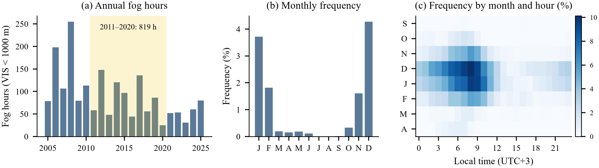
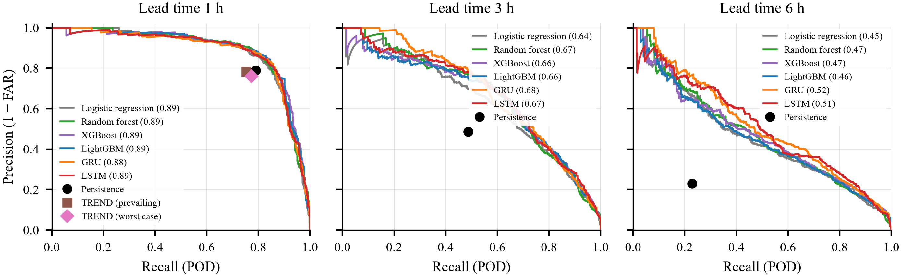
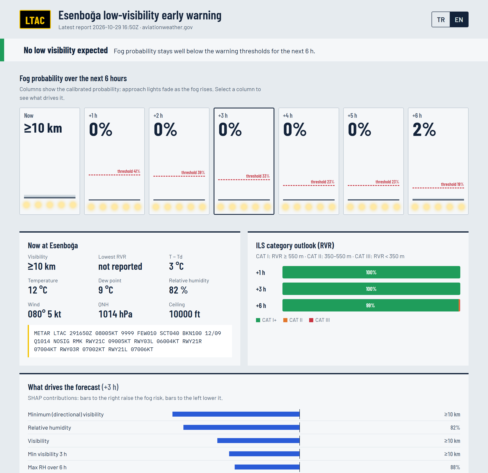

# Explainable ML nowcasting of fog and low visibility at Ankara Esenboğa Airport (LTAC)

**Ankara Esenboğa Havalimanı'nda sis ve düşük görüşün açıklanabilir makine öğrenmesiyle kısa vadeli tahmini**

Term project for **YMH453 Machine Learning**, Department of Software Engineering, Ankara University (2026–2027 fall) — Ata Sakik.

This repository contains everything needed to reproduce the study: a 21.8-year quality-controlled
METAR/SPECI data set for LTAC (2005–2026), a purpose-built METAR/TAF decoder, six model families
(logistic regression, random forest, XGBoost, LightGBM, multi-task GRU/LSTM) forecasting fog
(visibility < 1000 m) and ILS/RVR categories 1, 3 and 6 h ahead, a complete verification against
persistence, climatology and the official METAR TREND, SHAP explanations, an IEEE-format paper in
English and Turkish, a presentation and a live web-based early-warning application.

> **Türkçe özet.** Kalite kontrolünden geçirilmiş 21,8 yıllık LTAC METAR/SPECI verisiyle sis
> (görüş < 1000 m) ve ILS kategorileri (RVR ≥ 550 m, 350–550 m, < 350 m) 1, 3 ve 6 saat önceden
> tahmin edilmiştir. Tüm modeller kalıcılık tahminini anlamlı biçimde geçmekte, LightGBM 1 saatte
> resmî METAR TREND tahminini CSI'da 0,105 farkla aşmaktadır. Makalenin Türkçe sürümü
> [`report/Esenboga_DusukGorus_Tahmini_IEEE_TR.pdf`](report/Esenboga_DusukGorus_Tahmini_IEEE_TR.pdf),
> sunum ise [`presentation/Esenboga_Sunum_TR.pptx`](presentation/Esenboga_Sunum_TR.pptx) dosyasındadır.

## Key results (test seasons 2022/23–2025/26, never used for training or tuning)

| Fog (VIS < 1000 m) | 1 h | 3 h | 6 h |
|---|---|---|---|
| Best CSI (model) | **0.729** (LightGBM) | **0.472** (LSTM) | **0.340** (LSTM) |
| Persistence CSI | 0.652 | 0.321 | 0.129 |
| Best PR-AUC (model) | 0.892 (XGBoost) | 0.685 (GRU) | 0.517 (GRU) |
| Best Brier skill score | 0.739 | 0.463 | 0.317 |

* All six models beat persistence at every lead time (paired day-block bootstrap, 95% CI excludes 0).
* At 1 h LightGBM beats the official METAR TREND: ΔCSI = **+0.105** [0.075, 0.140].
* ILS categories: RPSS 0.64 / 0.41 / 0.28 at 1 / 3 / 6 h (persistence 0.43 / −0.17 / −0.70).
* SHAP: the current humidity/visibility state dominates at 1 h (78% of attribution); at 6 h the
  solar cycle (28%) and boundary-layer memory (21%) take over — the physics of radiation fog.
* The data set reproduces the published climatology: 819.5 fog hours in 2011–2020 (≈800 h in
  Koyuncu et al., 2022), 94.6% of fog in October–February, RVR ≤ 350 m in 55.5% of fog cases.




## Deliverables

| | English | Türkçe |
|---|---|---|
| IEEE Transactions-format paper | [`report/Esenboga_LowVisibility_Nowcasting_IEEE_EN.pdf`](report/Esenboga_LowVisibility_Nowcasting_IEEE_EN.pdf) (`.docx` alongside) | [`report/Esenboga_DusukGorus_Tahmini_IEEE_TR.pdf`](report/Esenboga_DusukGorus_Tahmini_IEEE_TR.pdf) |
| Presentation (15 slides, speaker notes) | [`presentation/Esenboga_Presentation_EN.pptx`](presentation/Esenboga_Presentation_EN.pptx) | [`presentation/Esenboga_Sunum_TR.pptx`](presentation/Esenboga_Sunum_TR.pptx) |
| Figures | `results/figures/en/` | `results/figures/tr/` |

## Repository layout

```
src/esenboga/      decoder (metar.py, taf.py), data assembly & QC, features, models, metrics,
                   deep models, baselines (persistence/TREND/TAF), inference for the web app
scripts/           01_prepare_data … 08_operational_replay (numbered pipeline steps)
app/               FastAPI server, live prediction log (SQLite) and the dashboard (HTML/CSS/JS)
data/              raw archives (METAR/SPECI, TAF) and processed features/targets — see data/README.md
models/            trained & calibrated models (joblib), tuned hyper-parameters
results/           tables (CSV/JSON), predictions, figures (EN/TR)
report/            manuscript sources (content_en.md, content_tr.md), builder, references, outputs
presentation/      deck generator (pptxgenjs) and the decks
tests/             parser, TAF, solar-geometry and look-ahead leakage tests
```

## Reproduce

```bash
python -m venv .venv && .venv\Scripts\activate          # Python 3.13
pip install -r requirements.txt                          # for a GPU: install torch from pytorch.org first
pwsh ./run_all.ps1                                       # downloads, trains, evaluates, builds the papers
```

Individual steps: `python scripts/01_prepare_data.py`, `python -m pytest tests`,
`python scripts/02_train_tabular.py`, `python scripts/03_train_deep.py`, `python scripts/05_evaluate.py`,
`python scripts/06_shap.py`, `python scripts/07_figures.py`, `python scripts/08_operational_replay.py`,
`python report/build_paper.py` (requires MS Word for the PDF export).

## Run the early-warning application

```bash
uvicorn app.server:app --port 8000        # then open http://localhost:8000  (?lang=en for English)
python app/live_log.py --loop             # optional: stand-alone live logger (every 10 min)
python app/live_log.py --summary          # real-time verification of the logged forecasts
```

The application downloads the latest METARs from the NOAA Aviation Weather Center (IEM as fallback),
runs exactly the same decoding, quality-control and feature code as the study, and shows calibrated
fog probabilities for 1–6 h, an ILS-category outlook, a tiered alert and SHAP-based driving factors.
Every forecast is stored and automatically verified when its valid time has passed. A parity test
(`scripts/08_operational_replay.py`) confirms that live and offline forecasts are identical.



## Data sources and citation

METAR/SPECI: Iowa Environmental Mesonet (Iowa State University); gap filling and TAFs: Ogimet
(G. Ballester Valor); live data and recent TAFs: NOAA Aviation Weather Center. See
[`data/README.md`](data/README.md) for processing details and provider citations.

```bibtex
@misc{sakik2026esenboga,
  author = {Ata Sakik},
  title  = {Explainable Machine Learning-Based Nowcasting of Fog and Low Visibility at Ankara Esenbo\u{g}a Airport},
  year   = {2026},
  note   = {YMH453 Machine Learning term project, Ankara University},
  url    = {https://github.com/AtaSakik/esenboga-fog-nowcasting}
}
```

## License

Code: MIT (see `LICENSE`). Meteorological reports remain subject to the terms of their providers.
