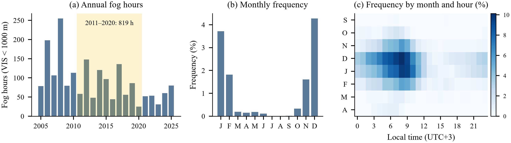
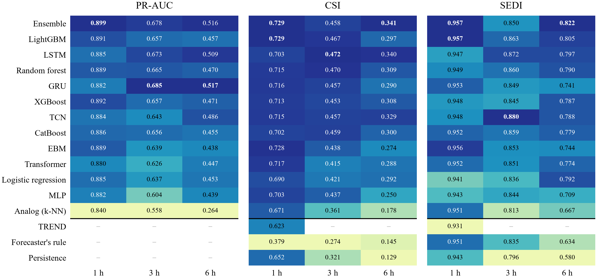
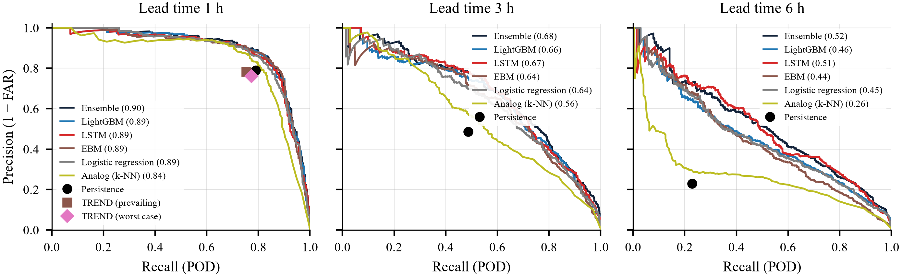
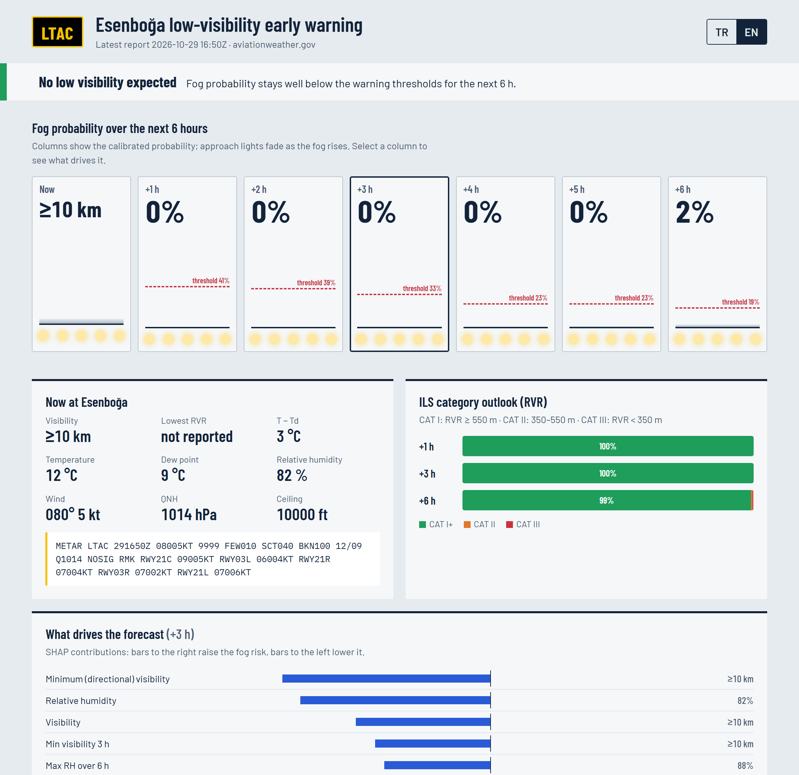

# Explainable ML nowcasting of fog and low visibility at Ankara Esenboğa Airport (LTAC)

**Ankara Esenboğa Havalimanı'nda sis ve düşük görüşün açıklanabilir makine öğrenmesiyle kısa vadeli tahmini**

Term project for **YMH453 Machine Learning**, Department of Software Engineering, Ankara University (2026–2027 fall) — Ata Sakik.

This repository contains everything needed to reproduce the study: a 21.8-year quality-controlled
METAR/SPECI data set for LTAC (2005–2026), a purpose-built METAR/TAF decoder, a benchmark of thirteen
techniques from six families (logistic regression, analog k-NN, random forest, XGBoost, LightGBM, CatBoost,
explainable boosting machine, MLP, multi-task GRU/LSTM/TCN/Transformer and a greedy ensemble) forecasting
fog (visibility < 1000 m) and ILS/RVR categories 1, 3 and 6 h ahead, a complete verification against
persistence, a forecaster's rule of thumb, climatology and the official METAR TREND (Holm-corrected
day-block bootstrap tests, SEDI, relative economic value, computational cost), SHAP explanations, an
IEEE-format paper in English and Turkish, a TÜBİTAK 2209-A proposal draft, a plain-language summary, a
presentation and a live web-based early-warning application.

> **Türkçe özet.** Kalite kontrolünden geçirilmiş 21,8 yıllık LTAC METAR/SPECI verisiyle sis
> (görüş < 1000 m) ve ILS kategorileri (RVR ≥ 550 m, 350–550 m, < 350 m) 1, 3 ve 6 saat önceden
> tahmin edilmiştir. Altı aileden on üç teknik karşılaştırılmış; yöntemleri birleştiren topluluk genel
> sıralamada birinci olmuş, 1 saatlik analog tahmin dışındaki tüm teknikler kalıcılığı anlamlı biçimde geçmiş, LightGBM 1 saatte
> resmî METAR TREND tahminini CSI'da 0,106 farkla aşmıştır. TÜBİTAK 2209-A öneri taslağı
> [`report/TUBITAK_2209A_Proje_Onerisi.pdf`](report/TUBITAK_2209A_Proje_Onerisi.pdf), herkes için sade
> özet [`report/Herkes_Icin_Ozet.pdf`](report/Herkes_Icin_Ozet.pdf) dosyasındadır. Makalenin Türkçe sürümü
> [`report/Esenboga_DusukGorus_Tahmini_IEEE_TR.pdf`](report/Esenboga_DusukGorus_Tahmini_IEEE_TR.pdf),
> sunum ise [`presentation/Esenboga_Sunum_TR.pptx`](presentation/Esenboga_Sunum_TR.pptx) dosyasındadır.
> Canlı erken uyarı sayfası, teknik bilgisi olmayan ziyaretçiler için sade Türkçeyle hazırlanmıştır:
> **https://atasakik.github.io/esenboga-fog-nowcasting/**

## Key results (test seasons 2022/23–2025/26, never used for training or tuning)

| Fog (VIS < 1000 m) | 1 h | 3 h | 6 h |
|---|---|---|---|
| Best CSI (technique) | **0.729** (ensemble, LightGBM) | **0.472** (LSTM) | **0.341** (ensemble) |
| Persistence CSI | 0.652 | 0.321 | 0.129 |
| Best PR-AUC (technique) | 0.899 (ensemble) | 0.685 (GRU) | 0.517 (GRU) |
| Best Brier skill score | 0.742 | 0.463 | 0.317 |

* Benchmark of 13 techniques: the greedy ensemble ranks first overall (mean rank 2.3), then LightGBM (3.9),
  LSTM (4.5) and random forest (4.8). Trees and the glass-box EBM lead at 1 h, recurrent networks at 3–6 h;
  most differences among the leaders are not significant (Holm-adjusted day-block bootstrap), while every
  technique outscores persistence, the forecaster's rule of thumb and the TREND (significantly so against
  persistence for all but the analog forecast at 1 h).
* At 1 h LightGBM beats the official METAR TREND: ΔCSI = **+0.106** [0.073, 0.138].
* Relative economic value at a cost/loss ratio of 0.05: 0.89 / 0.77 / 0.70 for the ensemble vs
  0.78 / 0.46 / 0.19 for persistence (1 / 3 / 6 h).
* ILS categories: RPSS 0.64 / 0.43 / 0.28 at 1 / 3 / 6 h for the ensemble (persistence 0.43 / −0.17 / −0.70).
* SHAP: the current humidity/visibility state dominates at 1 h (78% of attribution); at 6 h the
  solar cycle (28%) and boundary-layer memory (21%) take over — the physics of radiation fog.
* The data set reproduces the published climatology: 819.5 fog hours in 2011–2020 (≈800 h in
  Koyuncu et al., 2022), 94.6% of fog in October–February, RVR ≤ 350 m in 55.5% of fog cases.





## Deliverables

| | English | Türkçe |
|---|---|---|
| IEEE Transactions-format paper | [`report/Esenboga_LowVisibility_Nowcasting_IEEE_EN.pdf`](report/Esenboga_LowVisibility_Nowcasting_IEEE_EN.pdf) (`.docx` alongside) | [`report/Esenboga_DusukGorus_Tahmini_IEEE_TR.pdf`](report/Esenboga_DusukGorus_Tahmini_IEEE_TR.pdf) |
| TÜBİTAK 2209-A proposal draft | – | [`report/TUBITAK_2209A_Proje_Onerisi.pdf`](report/TUBITAK_2209A_Proje_Onerisi.pdf) (`.docx` alongside) |
| Plain-language summary | – | [`report/Herkes_Icin_Ozet.pdf`](report/Herkes_Icin_Ozet.pdf) |
| Presentation (16 slides, speaker notes) | [`presentation/Esenboga_Presentation_EN.pptx`](presentation/Esenboga_Presentation_EN.pptx) | [`presentation/Esenboga_Sunum_TR.pptx`](presentation/Esenboga_Sunum_TR.pptx) |
| Figures | `results/figures/en/` | `results/figures/tr/` |

## Repository layout

```
src/esenboga/      decoder (metar.py, taf.py), data assembly & QC, features, models, metrics,
                   deep models, baselines (persistence/TREND/TAF), inference for the web app
scripts/           01_prepare_data … 10_benchmark (pipeline steps; order in run_all.ps1)
app/               FastAPI server, live prediction log (SQLite) and the dashboard (HTML/CSS/JS)
data/              raw archives (METAR/SPECI, TAF) and processed features/targets — see data/README.md
models/            trained & calibrated models (joblib), tuned hyper-parameters
results/           tables (CSV/JSON), predictions, figures (EN/TR)
report/            paper sources (content_en/tr.md), proposal_tr.md, summary_tr.md, builders, references
presentation/      deck generator (pptxgenjs) and the decks
tests/             parser, TAF, solar-geometry and look-ahead leakage tests
```

## Reproduce

```bash
python -m venv .venv && .venv\Scripts\activate          # Python 3.13
pip install -r requirements.txt                          # for a GPU: install torch from pytorch.org first
pwsh ./run_all.ps1                                       # downloads, trains, evaluates, builds the papers
```

Individual steps: `python scripts/01_prepare_data.py`, `python -m pytest tests`,
`python scripts/02_train_tabular.py`, `python scripts/03_train_deep.py`, `python scripts/09_ensemble.py`,
`python scripts/05_evaluate.py`, `python scripts/10_benchmark.py`, `python scripts/06_shap.py`,
`python scripts/07_figures.py`, `python scripts/08_operational_replay.py`, `python report/build_paper.py`
and `python report/build_docs.py` (both require MS Word for the PDF export).

## Live dashboard (serverless, free)

**https://atasakik.github.io/esenboga-fog-nowcasting/** — run every 30 minutes by the GitHub
Actions workflow [`.github/workflows/live-nowcast.yml`](.github/workflows/live-nowcast.yml), which fetches
the latest LTAC METARs, logs and verifies the calibrated forecasts and republishes the dashboard to
GitHub Pages. The prediction database is kept on the single-commit branch `live-data`. GitHub's scheduler
often delays or skips runs, so each run, which downloads the last 7 days of reports, also computes the forecasts for
the issue times skipped during roughly the previous three days from the reports observed up to those times (later
corrections included) and stores them as `mode='catchup'`, separately from the real-time (`mode='live'`) record.

Runs start at HH:10 and HH:40 UTC, because aviationweather.gov receives the routine METARs of HH:20 and HH:50
8–17 minutes after their observation time. For punctual runs, an external scheduler such as
[cron-job.org](https://cron-job.org) calls the workflow-dispatch endpoint at those minutes, with a fine-grained token
that is limited to this repository and to *Actions: Read and write*:

```text
POST https://api.github.com/repos/AtaSakik/esenboga-fog-nowcasting/actions/workflows/live-nowcast.yml/dispatches
Accept: application/vnd.github+json
Authorization: Bearer <token>
X-GitHub-Api-Version: 2022-11-28
Content-Type: application/json

{"ref": "main"}
```

GitHub's own, often late, schedule is the fallback in a separate workflow,
[`.github/workflows/live-nowcast-fallback.yml`](.github/workflows/live-nowcast-fallback.yml), which starts the live
workflow only when no run has begun in the last 25 minutes. `live-nowcast.yml` itself has no schedule, so GitHub's
rule that turns off scheduled workflows of public repositories after 60 days without repository activity can stop
only the fallback, never the external trigger. To analyse the live record locally (e.g. at the end of the semester):

```bash
git fetch origin live-data
git show origin/live-data:live_predictions.sqlite > logs/live_predictions.sqlite   # Git Bash (binary-safe)
python app/live_log.py --summary
python scripts/08_operational_replay.py   # reads live-data itself; live and catch-up rows reported separately
```

## Run the early-warning application locally

```bash
uvicorn app.server:app --port 8000        # then open http://localhost:8000  (?lang=en for English)
python app/live_log.py --loop             # optional: stand-alone live logger (every 10 min)
python app/live_log.py --summary          # real-time verification of the logged forecasts
pwsh ./app/register_task.ps1              # Windows: run the logger every 30 min via Task Scheduler
```

The application downloads the latest METARs from the NOAA Aviation Weather Center (IEM as fallback),
runs exactly the same decoding, quality-control and feature code as the study, and shows, in plain
Turkish (English on request) for non-specialist visitors, a one-sentence status, calibrated fog
probabilities for 1–6 h against their warning thresholds, an ILS-category outlook and the driving
factors of each forecast (TreeSHAP contributions summed into ten plain-language groups such as
humidity, wind and time of day).
Every forecast is stored and automatically verified when its valid time has passed. A parity test
(`scripts/08_operational_replay.py`) confirms that live and offline forecasts are identical.



## Data sources and citation

METAR/SPECI: Iowa Environmental Mesonet (Iowa State University); gap filling and TAFs: Ogimet
(G. Ballester Valor); live data and recent TAFs: NOAA Aviation Weather Center. See
[`data/README.md`](data/README.md) for processing details and provider citations.

```bibtex
@misc{sakik2026esenboga,
  author = {Ata Sakik},
  title  = {Explainable Machine Learning-Based Nowcasting of Fog and Low Visibility at Ankara Esenbo\u{g}a Airport},
  year   = {2026},
  note   = {YMH453 Machine Learning term project, Ankara University},
  url    = {https://github.com/AtaSakik/esenboga-fog-nowcasting}
}
```

## License

Code: MIT (see `LICENSE`). Meteorological reports remain subject to the terms of their providers.
